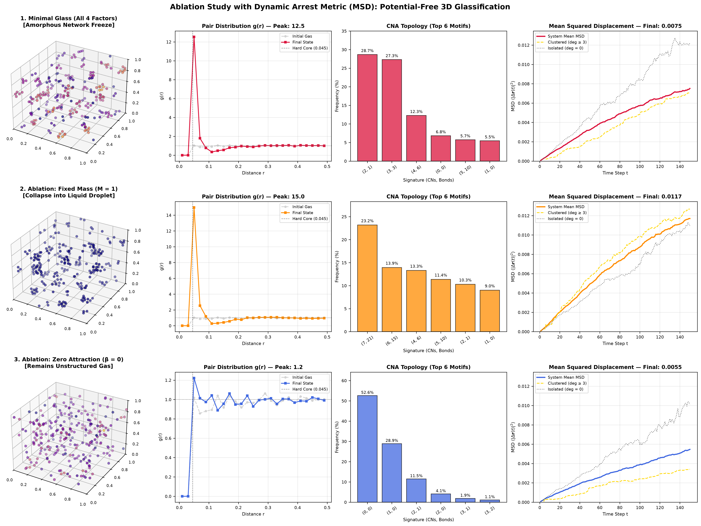
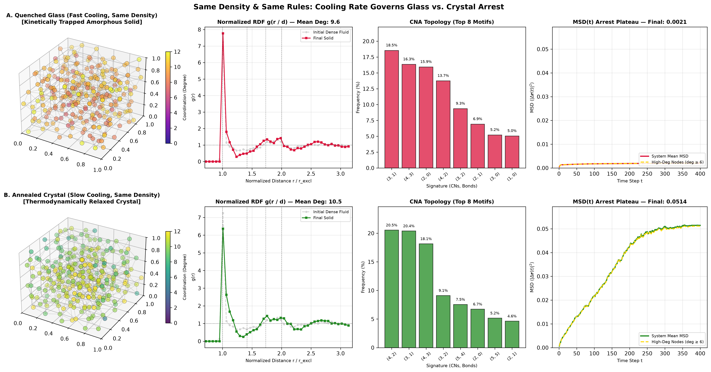
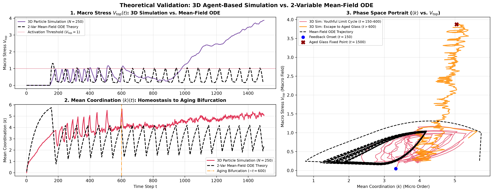

# Minimal Kinetic 3D Glassification & Aging Bifurcation

Simulation codes and theoretical validation for a minimal, potential-free 3D particle model of kinetic glassification, thermal history dependence, and aging bifurcation.

## Overview

This repository demonstrates how amorphous network arrest (glassification), crystallization, and aging dynamics emerge from simple microscopic rules without explicit multi-body angular potentials:
1. **Short-range bond attraction** ($\beta$)
2. **Degree-dependent effective mass** ($M_{\mathrm{eff}} = 1 + \alpha k$, kinematic arrest)
3. **Hard-sphere excluded volume** ($r_{\mathrm{excl}}$)
4. **Thermal fluctuations** ($\sigma$)

---

## Repository Structure

* `01_ablation_study_with_msd.py` — Ablation study isolating the role of effective mass and attraction using 3D structure, radial distribution function $g(r)$, Common Neighbor Analysis (CNA), and Mean Squared Displacement (MSD).
* `02_same_density_glass_vs_crystal.py` — Comparison of **quenched glass** vs. **annealed crystal** under identical packing fraction ($\phi \approx 48\%$) and identical microscopic rules, differing solely in cooling rate.
* `03_mean_field_ode_validation.py` — Theoretical validation comparing 3D agent-based simulations ($N=250$) against a two-variable nonlinear Mean-Field ODE ($\langle k \rangle(t), V_{\mathrm{top}}(t)$) capturing the transition from homeostatic limit cycles to an aged glass fixed point.
* `jp/` — Japanese-commented versions of the simulation scripts.

---

## Results & Figures

### 1. Ablation Study with Dynamic Arrest Metric (MSD)
```bash
python 01_ablation_study_with_msd.py
```


### 2. Cooling Rate Governs Glass vs. Crystal Arrest (Same Density)
```bash
python 02_same_density_glass_vs_crystal.py
```


### 3. Theoretical Validation: 3D Simulation vs. 2-Variable Mean-Field ODE
```bash
python 03_mean_field_ode_validation.py
```


---

## Requirements & Quick Start

```bash
git clone https://github.com<your-username>/minimal-3d-kinetic-glass.git
cd minimal-3d-kinetic-glass
pip install -r requirements.txt
```

## Citation & Attribution

This software and its figures are free to use for personal, academic, and commercial purposes, provided that proper attribution is given. If you use this code or model in your research, publication, or project, please cite it as follows:

<Ryo Muramoto> (2026). *Minimal Kinetic 3D Glassification & Aging Bifurcation*. GitHub repository: https://github.com<your-username>/minimal-3d-kinetic-glass

## License

This project is licensed under the **MIT License** — see the [LICENSE](LICENSE) file for details. Free for personal, academic, and commercial use with attribution.
